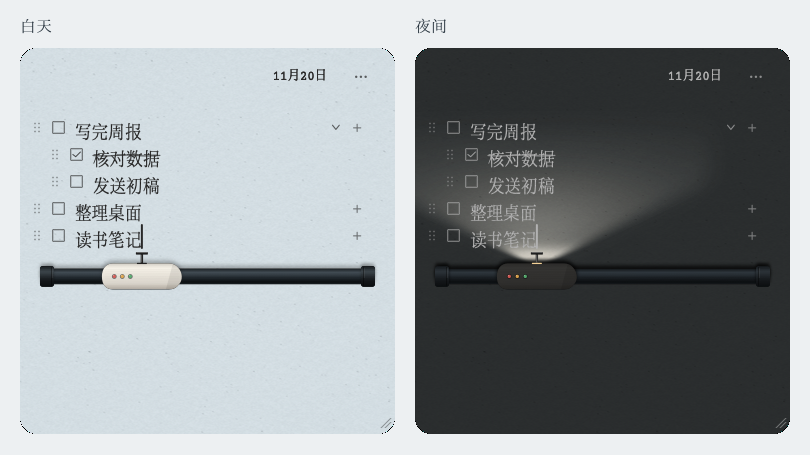
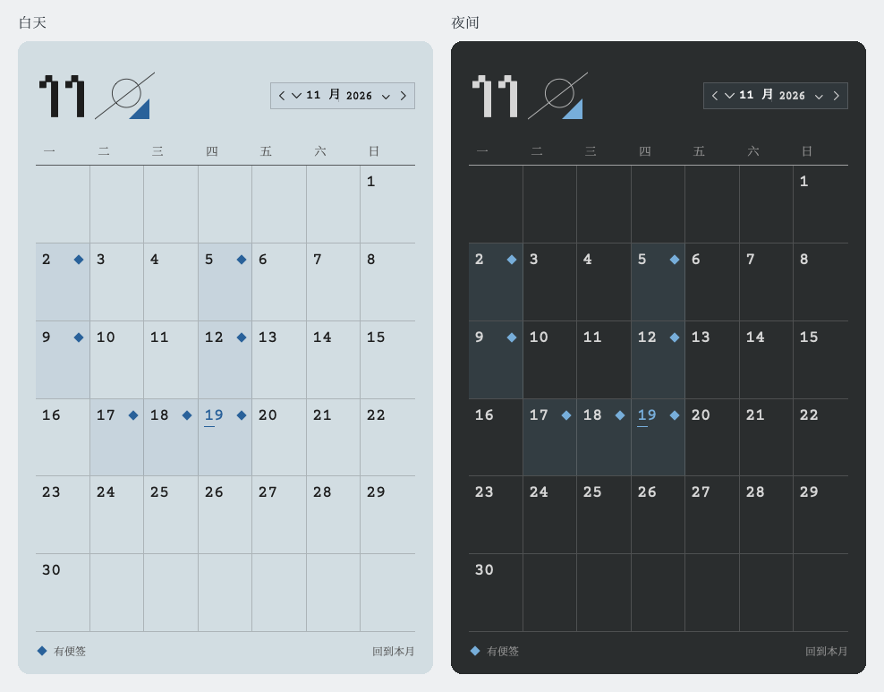

# Paperframe

一张放在桌面边上的便签。写几件今天想做的事，做完就划掉。打字时，纸上的小打字机会跟着光标走。晚上可以给它开一盏灯。

[下载最新版](https://github.com/soda576/paperframe/releases/latest)

| 电脑 | 下载 | 怎么打开 |
| --- | --- | --- |
| Mac | `Paperframe-1.0.0-macOS-universal.dmg` | 打开 DMG，把 Paperframe 拖到「应用程序」。支持 macOS 13 及更新版本，兼容 Apple Silicon 和 Intel。 |
| Windows | `Paperframe-1.0.0-Windows-x64.exe` | 支持 Windows 10 / 11 x64。双击就能打开便签，可以把 EXE 留在平时好找的位置。 |

首发安装包使用临时签名或未签名，macOS 与 Windows 可能会提示开发者身份未验证。



## 写下今天的事

- **把任务写在桌面上。** 支持中英文，回车换到下一项，勾选方框就划掉这一行。窗口大小可以调整，也可以置顶。
- **把大事拆小。** 点任务右侧的「＋」写子任务。只有写过子任务的那一行才会出现折叠箭头。顺序变了，就抓住左边的把手拖一下。
- **回头看日历。** 蓝色菱形标出写过便签的日期。点进去还可以继续写、调整顺序或勾选。Mac 的月度回顾还会把完成情况排成按天、周、月切换的网格。
- **挑一张顺眼的纸。** 可以跟随系统切换白天和夜间，也可以单独调字体、字号、行距、纸色和灯光。Mac 还支持透出桌面的玻璃背景、模糊调节，以及更完整的打字机和拖动动效。



## 数据放在哪里

便签会按日期保存在本机。Paperframe 无需登录，也没有云端同步。换电脑前，可以备份对应的数据目录。

- macOS 在 `~/Library/Application Support/纸间打字机/`
- Windows 在 `%APPDATA%\Paperframe\`

## 从源码运行

Mac 使用 Swift 和 AppKit，需要 macOS Command Line Tools。

```sh
bash build.sh
open build/Paperframe.app
```

用 `bash scripts/package-macos.sh` 可以生成通用 DMG。

Windows 版使用 Electron。安装 Node.js 24 后，从仓库根目录运行：

```sh
cd windows
npm ci
npm start
```

运行 `npm test` 检查数据逻辑。可以在 Windows 上用 `npm run package` 生成免安装 EXE。

Paperframe 的代码采用 [MIT 许可](LICENSE)。字库、音效和纸纹的出处与授权见[资源与授权](资源与授权.txt)。
